# BSPWM Window Manager Entorno Completo para Arch Linux / Ubuntu (branch ubuntu)
<div align = center>

&ensp;[<kbd> <br> Complementos <br> </kbd>](#Features)&ensp;
&ensp;[<kbd> <br> Aspecto <br> </kbd>](#Theme)&ensp;
&ensp;[<kbd> <br> Shortcuts <br> </kbd>](#Shortcuts)&ensp;
&ensp;[<kbd> <br> Instalar <br> </kbd>](#Install)&ensp;
&ensp;[<kbd> <br> Wiki <br> </kbd>](#Wiki)&ensp;

<br>

## Features

**Eww Widgets**

<sup>Calendario, Tarjeta de usuario y cheatsheet con shortcut.</sup>

**Menus Rofi**

<sup>Menu de aplicaciones, de screenshots, clipboard (con greenclip), NetworkManager, BluetoothManager, AndroidMount y PowerMenu.</sup>

**Picom**

<sup>Estetica sin perder rendimiento.</sup>

**Configuración Completa de Neovim**

<sup>Una configuración completa de neovim con plugins y totalmente personalizable. Vive en su propio repo, [Nvim-Config](https://github.com/Jimmy4TK/Nvim-Config), y el instalador la clona si querés probarla.</sup>

**Configuración de ZSH**

<sup>Una configuración simple de ZSH para poder personalizarla a gusto, con plugins instalados para resaltar la sintaxis, autocompletado y una estetica limpia.</sup>

**Polybar**

<sup>Barra con launcher de aplicaciones, workspaces con estetica de pacman, acceso a la tarjeta de usuario, actualizaciones pendientes, ip, sistema de target para ciberseguridad, uso de almacenamiento, procesador, ram e internet; fecha y hora y boton de apagado.</sup>

**Tmux**

<sup>Terminal multiplexer con sessionizer y scripts personalizables para cada directorio. Vive en su propio repo, [Tmux-Config](https://github.com/Jimmy4TK/Tmux-Config), y el instalador la clona junto con TPM si querés probarla.</sup>

## Theme

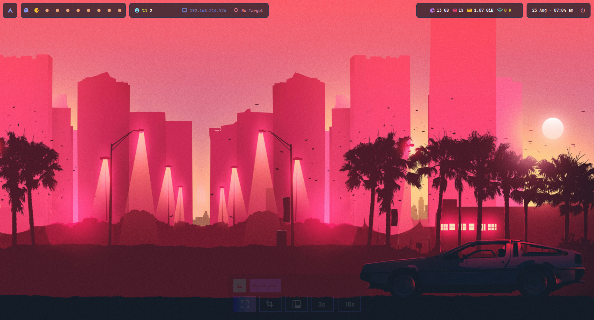
<details>
<summary><b>Aspecto de Zsh con tmux</b></summary>
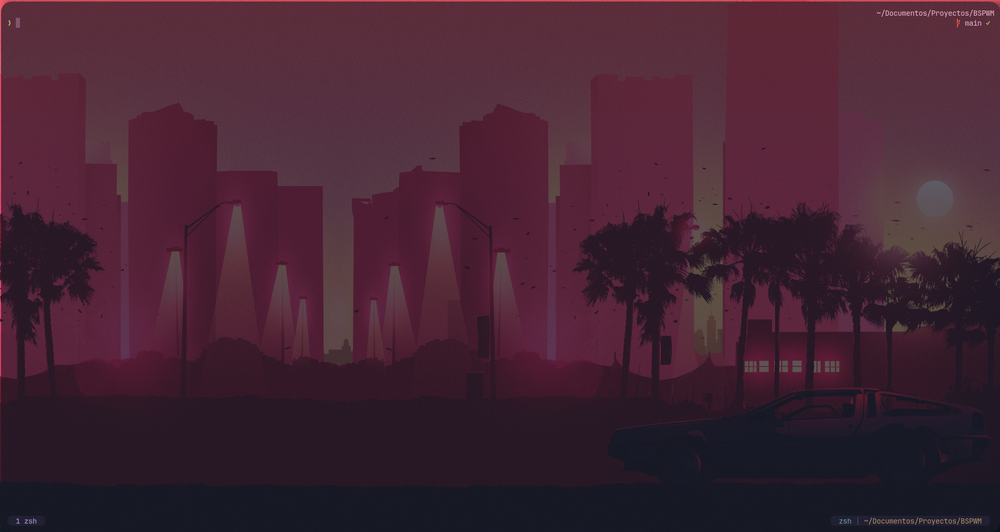
</details>
<details>
<summary><b>Aspecto de Neovim con Tmux</b></summary>
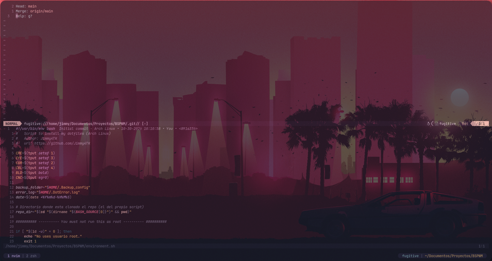
</details>
<details>
<summary><b>Aspecto de Menu de Apagado</b></summary>
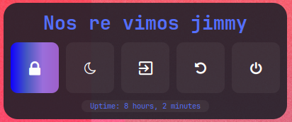
</details>
<details>
<summary><b>Aspecto de Menu de Aplicaciones</b></summary>
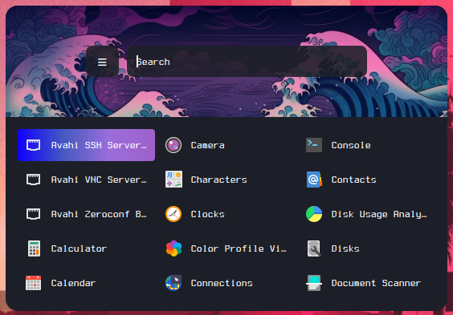
</details>
<details>
<summary><b>Aspecto de Carta de perfil</b></summary>
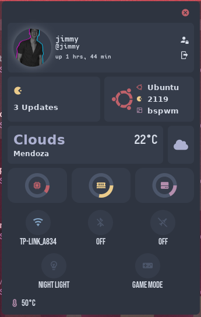
</details>
<details>
<summary><b>Aspecto de Lock de Rick y Morty</b></summary>

</details>
<details>
<summary><b>Aspecto de Controlador de Capturar Pantalla</b></summary>
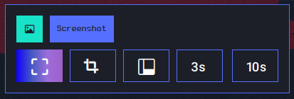
</details>
<details>
<summary><b>Aspecto de Controlador de Portapapeles</b></summary>
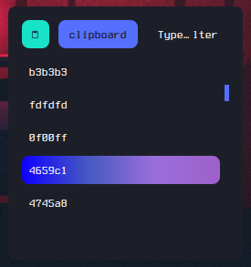
</details>
<details>
<summary><b>Aspecto de Controlador de Red</b></summary>
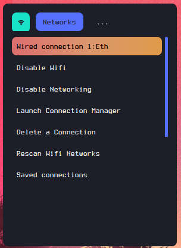
</details>
<details>
<summary><b>Aspecto de Controlador de Bluetooth</b></summary>
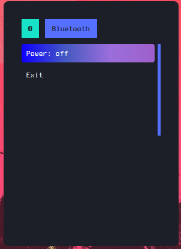
</details>

## Shortcuts

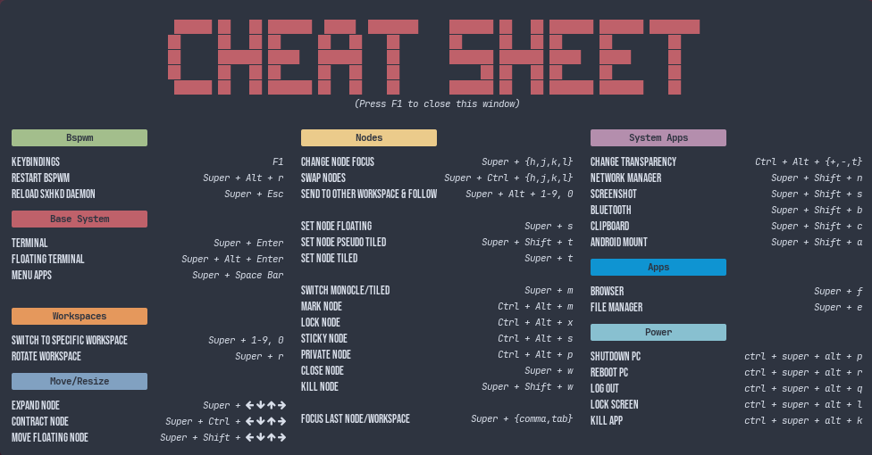

## Install
</div>

Para instalar en Arch

```
git clone https://github.com/Jimmy4TK/BSPWM ~/BSPWM
~/BSPWM/environment.sh
```

Para instalar en Ubuntu

```
git clone -b ubuntu https://github.com/Jimmy4TK/BSPWM ~/BSPWM
~/BSPWM/environment.sh
```

## Créditos y licencia

Gran parte de esta configuración deriva de los [dotfiles de gh0stzk](https://github.com/gh0stzk/dotfiles), bajo GPL-3.0. Este repositorio también se distribuye bajo [GPL-3.0](LICENSE). El detalle de los archivos y de otros componentes de terceros está en [NOTICE.md](NOTICE.md).
